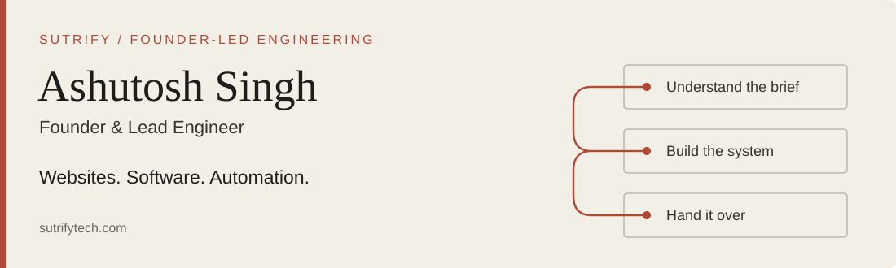
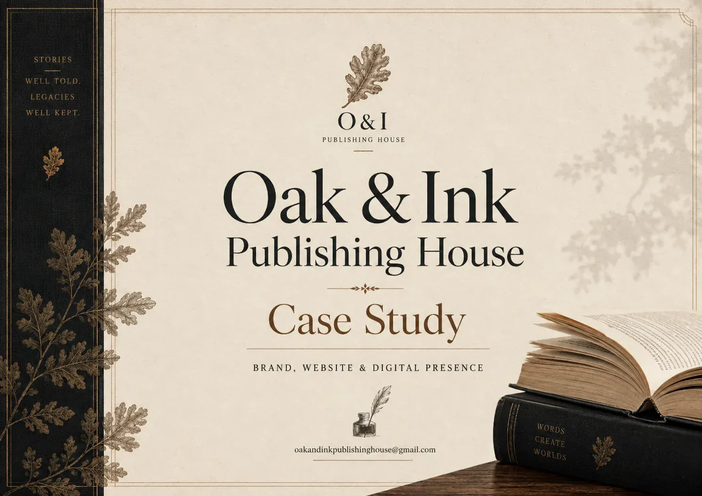
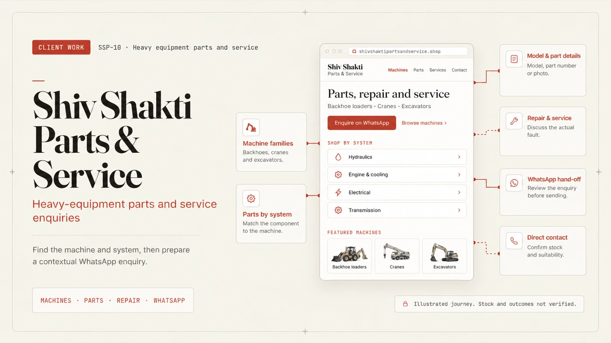
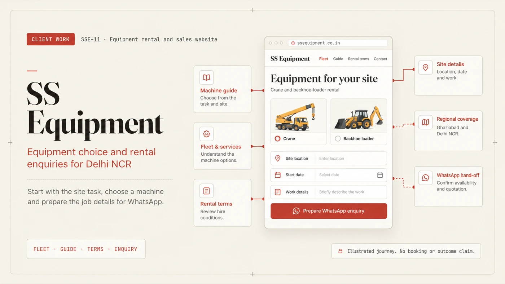
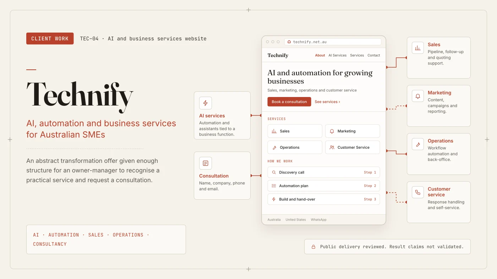

# Ashutosh Singh

**Founder & Lead Engineer at [Sutrify](https://sutrifytech.com).** I turn business requirements into websites, custom software and connected workflows.

I own the work from the first scope discussion to the code, deployment and handover. My focus is software that people can actually use to run a business: customer-facing platforms, internal tools, enquiries, approvals and the integrations between them.

[**Discuss a project**](https://sutrifytech.com/contact) · [Client work](https://sutrifytech.com/work) · [LinkedIn](https://www.linkedin.com/in/ashutosh-singh-sutrify/) · [ceo@sutrifytech.com](mailto:ceo@sutrifytech.com)

## About me

I'm **Ashutosh Singh**, usually **Ashu**, a software engineer and the founder of Sutrify, based in Greater Noida, India. I'm studying B.Tech Computer Science at NIET Autonomous while building client software and my own projects.

Much of my learning has happened through building outside the classroom. I've worked across web development, backend systems, databases, cloud deployment, automation, Android and AI. Following a problem through these layers is what interests me: how information enters a system, how decisions are made, where it can fail and what the person using it needs next.

Sutrify grew out of website development and client work. Working with business owners changed the questions I asked. A website enquiry needs a follow-up. A dashboard needs dependable data. An automation needs someone to handle the exceptions. That pushed my work towards complete business systems: platforms, internal tools, workflows and integrations that fit how a business actually operates.

Being a founder also means learning the work around the code. I'm developing my skills in discovery, scoping, pricing, proposals, client communication and delivery management. My aim is to build Sutrify into a dependable software company, with trust earned through work people can inspect and use.

I learn best by building something, testing it, tracing what breaks and understanding why. I enjoy difficult technical problems, especially where software meets devices, operating systems or real-world processes. Ownership matters to me: I want to understand the system well enough to maintain it and explain the decisions behind it.

Away from project work, I enjoy experimenting with devices and rooted Android, music, FPS games and futuristic interfaces. I'm also interested in human behaviour, psychology and decision-making. I like conversations about why people and systems work the way they do.

### What I'm building towards

- **Sutrify:** a software business built around direct client relationships, reliable delivery and useful business systems.
- **Sutra:** my long-term personal AI companion project. I'm exploring memory, context, voice and actions on Android, with the aim of making an assistant useful across everyday tasks. It is an ongoing development project.
- **AI workflows and systems:** experiments with agents, automation and integrations, alongside deeper learning in backend architecture, security and deployment.

### What matters to me

- **Evidence:** describe what has actually been built and tested, and be clear about what still needs work.
- **Understanding:** trace a problem to its cause and learn how the underlying system behaves.
- **Ownership:** take responsibility for the scope, implementation and handover.
- **Usefulness:** make technical decisions around the people who have to use and maintain the software.

## Building Sutrify

| Build | Automate | Improve |
| --- | --- | --- |
| Business websites, custom web platforms, customer portals and MVPs | Enquiry handling, internal workflows, API integrations and AI-assisted features | Existing applications, deployment, maintenance and technical recovery |

**One engineer accountable throughout.** I agree the scope in writing, build in working increments and hand over the code, accounts and documentation.

## Selected client work

<table>
<tr>
<td width="50%" valign="top">

<h3><a href="https://sutrifytech.com/work/oak-and-ink-publishing-house">Oak & Ink Publishing House</a></h3>

Brand and a publishing platform for readers and authors.

Client engagement · In delivery

</td>
<td width="50%" valign="top">

<h3><a href="https://sutrifytech.com/work/shiv-shakti-parts-and-service">Shiv Shakti Parts & Service</a></h3>

Machine discovery, parts and repairs, with contextual WhatsApp enquiries.

Client website · Live

</td>
</tr>
<tr>
<td width="50%" valign="top">

<h3><a href="https://sutrifytech.com/work/ss-equipment">SS Equipment</a></h3>

Equipment guides, rental information and structured site enquiries.

Client website · Live

</td>
<td width="50%" valign="top">

<h3><a href="https://sutrifytech.com/work/technify">Technify</a></h3>

Australian AI, automation and business-services website.

Client website · Live

</td>
</tr>
</table>

The covers are case-study artwork. Each linked record explains the actual scope, implementation and limits.

[**Explore all Sutrify client work and engineering builds →**](https://sutrifytech.com/work)

## Engineering you can inspect

| Project | Engineering focus | Current scope |
| --- | --- | --- |
| [**NIET Unified ERP**](https://github.com/Ashutoshsingh20/niet-unified-erp) | TypeScript, PostgreSQL, scoped authorization, governed workflows, audit records and transactional outbox | On-premise platform in development. Institutional acceptance pending. |
| [**SmartEvent AI**](https://github.com/Ashutoshsingh20/SmartEvent-AI) | Firebase authentication, event registration, QR tickets, camera check-in and Firestore listeners | Engineering demonstration. Payment flow is simulated. |
| [**Argent Sentinel**](https://github.com/Ashutoshsingh20/argent-sentinel) | FastAPI telemetry ingestion, TabNet trust inference, background model training and enforcement simulation | Defensive-security research prototype. No production security certification claimed. |
| [**Kalpana Drive**](https://github.com/Ashutoshsingh20/Kalpana_Drive) | SwiftUI iPad dashboard, safety state machine, provider abstractions and mock services | Phase 1 foundation. Phone and vehicle integrations remain future work. |

[ERP architecture](https://github.com/Ashutoshsingh20/niet-unified-erp/blob/main/PHASE_0_ARCHITECTURE.md) · [Event-platform write-up](https://sutrifytech.com/work/event-management-platform) · [Security research write-up](https://sutrifytech.com/work/argent-sentinel) · [Drive architecture](https://github.com/Ashutoshsingh20/Kalpana_Drive/blob/main/documentation/ARCHITECTURE.md)

## How I work

1. **Understand the operation.** Find the actual problem, users, constraints and existing tools.
2. **Make the scope concrete.** Agree what will be built, the milestones and the ownership.
3. **Build and review.** Share working increments and make progress inspectable.
4. **Deploy and hand over.** Transfer the code and accounts with setup and operating documentation.

## Technical toolkit

| Area | Tools |
| --- | --- |
| Web and backend | TypeScript, JavaScript, React, Next.js, Node.js, Python, FastAPI |
| Data and deployment | PostgreSQL, Supabase, Cloudflare Workers, D1, R2, Docker, Git |
| Mobile and systems | Kotlin, Android, SwiftUI |
| Integration | REST APIs, AI APIs, workflow automation |

---

### Let's build something useful.

For business websites, custom platforms or operational software, start with the problem you need solved.

**[Send a short requirement →](https://sutrifytech.com/contact)**  
[ceo@sutrifytech.com](mailto:ceo@sutrifytech.com) · [sutrifytech.com](https://sutrifytech.com)
